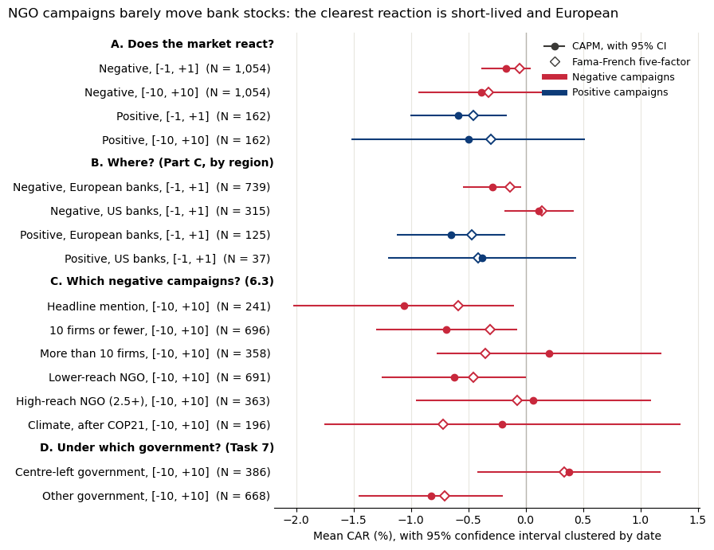

# Do NGO campaigns move bank stocks?

An event study of 1,301 NGO campaigns against 55 listed US and European banks, 2010–2018: whether investors react, which campaigns matter, and whether press coverage and the political context change the reaction.

**Course:** 20598 – Finance with Big Data, Bocconi University (Instructor: Clément Mazet-Sonilhac)
**Team (Group 7):** Cecilia Lo Cicero, Sara Pulidori, Alissa Sharuda, Nico Visentin

> **Data notice.** This project uses proprietary, licensed data (Sigwatch, LSEG Datastream, Dow Jones Factiva) that we accessed through Bocconi University for coursework. **None of that data is included in this repository**, and the notebook cannot be re-run without your own licensed access. The repository contains the code, the aggregate results and the figures only. See [Data](#data).

---

## Key findings

**NGO campaigns move bank stocks very little on average. The clearest reactions are small, short-lived, limited to European banks, and depend on how visible the campaign is.**

*Mean cumulative abnormal return (CAR) by group, with 95% confidence intervals clustered by event date. Filled circle = CAPM (main model); open diamond = Fama–French five-factor model (robustness check).*

1. **Negative campaigns have no robust effect.** The mean CAR on [−10, +10] trading days is −0.39%, the predicted sign. It is significant under the Boehmer test but not once standard errors are clustered by date (t = −1.38) or by month. Unlike Krüger (2015) for corporate social responsibility news in general, we find no robust average effect.
2. **Positive campaigns also lower returns.** Positive campaigns (an NGO praising a bank) lower returns by −0.59% on [−1, +1]. The result is significant on every test and robust to every check, but rests on only 162 events. One reading: any NGO attention is a risk signal.
3. **The reaction is European.** US banks show no reaction in any window or model. European banks fall by about 0.29% on [−1, +1] after negative campaigns and by 0.65% after positive ones. Under the Fama–French five-factor model, the European negative effect halves and loses significance.
4. **Visibility matters more than the issue.** Campaigns that name the bank in the headline (−1.06%) and campaigns that name 10 firms or fewer (−0.69%) are the only groups of negative campaigns whose intervals lie below zero. Their gaps to the other campaigns are not significant at 5% (p = 0.10 and 0.12). NGO reach goes the wrong way, and climate campaigns do not change after the Paris Agreement (COP21; difference-in-differences +0.76 pp, p = 0.49).
5. **Press echo is rare and possibly powerful.** In a random sample of 300 campaigns searched in Factiva (252 eligible), only 13 (5.2%) received major press or newswire coverage within 7 days, and no campaign characteristic significantly predicts coverage. The 7 negative events with press echo fall by −4.76% on [−10, +10], against −0.36% for the rest (gap p = 0.005). With 7 events and possible reverse causality, this is a lead for further work, not a firm result.
6. **Politics matters, against our hypothesis.** We expected campaigns to bite harder under centre-left governments, where the regulatory threat is more credible. Instead, negative campaigns lower returns under centre-right and other governments (−0.83%) and not under centre-left ones (+0.38%). The gap survives country fixed effects, but it is driven partly by the 2016 US election and depends on some coding choices.
7. **Text sentiment does not replace hand-coded tone.** FinBERT agrees only weakly with Sigwatch's hand-coded tone (Spearman 0.10, AUC 0.60), because Sigwatch codes the bank's stance relative to the NGO's demand, not the wording. Only 39% of the campaigns' source links still work.

**Timing.** There is no drift before the campaign date, and prices move from day +1, which is consistent with the Sigwatch date being a database entry date rather than the publication date.

All results are descriptive and observational. With many splits tested, the group-level patterns should be read as suggestive rather than confirmed.

## What we did

| Part | Question | Method |
|---|---|---|
| **A. NGO data** | Which banks are targeted, by whom, how? | Cleaned Sigwatch 2010–2018, filtered to US/UK/EU listed banks, matched target names to Datastream ISINs; one row per bank-day; flags for mass campaigns (> 10 firms named), climate, and opposite-sign campaigns; 30-day non-overlap rule |
| **A6. Media echo** (Task 1) | Did the press pick the campaign up? | Random sample of 300 campaigns; batched Factiva queries over a fixed panel of major outlets and newswires; LLM-assisted relevance screening and deduplication; echo = accepted story in calendar days 0–7; Fisher–Freeman–Halton exact tests with Holm correction |
| **A7. NLP** (Task 3) | Does text sentiment match Sigwatch's tone? | FinBERT (main) and VADER (baseline) on campaign text and on linked pages; link-rot check on 2,175 URLs |
| **B. Market data** (Task 4) | What is the expected return? | Daily USD return panel (ECB FX), 4-week T-bill risk-free rate, rolling CAPM and Fama–French five-factor betas on [t−300, t−50] |
| **C. Event study** (Task 5) | Do returns react? | CARs on [−1, +1], [−5, +5], [−10, +10]; Boehmer, Cowan sign, and t-tests clustered by date and month; robustness to β = 1, raw returns, clean windows, stale prices, overlap rules; leave-one-out bank-sector benchmark; split by region |
| **D. Campaign characteristics** (Task 6) | Which campaigns matter? | Splits by tone, number of firms named, prominence, NGO reach, climate × COP21, exploratory 2016 US election test, press echo; cross-sectional regression; CAR path |
| **D. Political context** (Task 7) | Does the government in power matter? | Party of the head of government in the bank's home country on the event date (ParlGov, US coded by hand); splits and regression with country fixed effects |

## Repository contents

| File | Purpose |
|---|---|
| `Hackathon.ipynb` | The full analysis, Parts A–D, with saved aggregate outputs and figures |
| `figures/` | Summary figure used in this README |
| `factiva_queries.py`, `factiva_echo_queries.py` | Build batched Factiva search strings from the campaign sample (do not access Factiva) |
| `factiva_process.py`, `factiva_echo_process.py` | Parse Factiva RTF exports and match articles to campaigns |
| `echo_aliases.py`, `echo_duplicates.py` | Bank/NGO name aliases and story deduplication |
| `factiva_review.js` | Browser page for manual relevance review of candidate articles |
| `finalize_echo.py` | Build the final campaign- and bank-level echo pools and join them to CARs |

## Data

| Source | Content | Provider / licence | Included? |
|---|---|---|---|
| **Sigwatch** | NGO campaign records 2010–2018: targets, tone, prominence, NGO reach, campaign text and links | Sigwatch, licensed via Bocconi | **No** – proprietary |
| **LSEG Datastream** | Daily prices, total return indices and company information for banks | LSEG (Refinitiv), licensed via Bocconi | **No** – proprietary |
| **Dow Jones Factiva** | Press and newswire articles for the echo sample, and our relevance labels | Dow Jones, licensed via Bocconi | **No** – proprietary |
| **US 4-week T-bill** | Daily risk-free rate | Course data pack | **No** |
| **Kenneth French Data Library** | Fama–French five-factor daily returns, Europe and North America | Public | Yes – `DATA/banks_data_bocconi/*_5_Factors_Daily.xlsx` (re-downloaded by the notebook if missing) |
| **ECB** | Daily EUR, GBP, SEK reference rates, converted to USD | Public | Yes – `DATA/banks_data_bocconi/fx_usd.csv` |
| **ParlGov** | Governments and party families | Public | Coded in the notebook (Task 7) |

The saved notebook outputs show only aggregate statistics (counts, means, test statistics, figures). No individual campaign texts, article contents or review labels are published.

**To re-run the notebook** you need your own licensed access to the proprietary sources. Add the files to the `DATA/` folder, next to the public files already there: Sigwatch `.dta` files in `DATA/sigwatch_data/`, and the Datastream workbooks and T-bill file in `DATA/banks_data_bocconi/`. Run the notebook from the repository root. It looks for a folder called `data`, which matches `DATA/` on macOS and Windows; on Linux, rename `DATA/` to `data/`. Intermediate files are written to `DATA/handoff/`. The Factiva step is manual: run `factiva_echo_queries.py`, run the searches in Factiva, save the exports, review candidates with `factiva_review.js`, then run `factiva_echo_process.py` and `finalize_echo.py`.

Python packages: `pandas`, `numpy`, `statsmodels`, `scipy`, `matplotlib`, `requests`, `vaderSentiment`, `transformers`, `torch`, `trafilatura`, `tqdm`.

## Limitations

- **Event date.** The Sigwatch date is when the campaign was recorded, which may differ from when it was published.
- **Overlapping events.** Many campaigns name several banks and some dates carry several campaigns; 24 of the 162 positive events fall on four dates.
- **Multiple testing.** We test about 15 splits plus exploratory breaks without a formal correction, so individual significant groups may be false positives.
- **Echo sample.** The echo sample is small, and exclusions are concentrated in 2013–2014. A campaign with no detected echo had no qualifying coverage in our searches; that does not prove no coverage existed.
- **Political coding.** Government coding involves judgment calls (Monti, Conte, Macron), and the political split overlaps with the 2016 US election.

## Further work

Correct for multiple testing (Romano–Wolf or Benjamini–Hochberg); use tests designed for clustered events (Kolari–Pynnönen, GRANK, calendar-time portfolios); scale the echo search to the full sample and use article dates as true publication dates; benchmark European banks against national indices; study volume, volatility or CDS spreads instead of returns; score only the sentences that mention the bank.

## Licence

The code is released under the MIT Licence (see `LICENSE`). The licence covers our code only. It grants no rights to the Sigwatch, Datastream or Factiva data, which remain the property of their providers.
